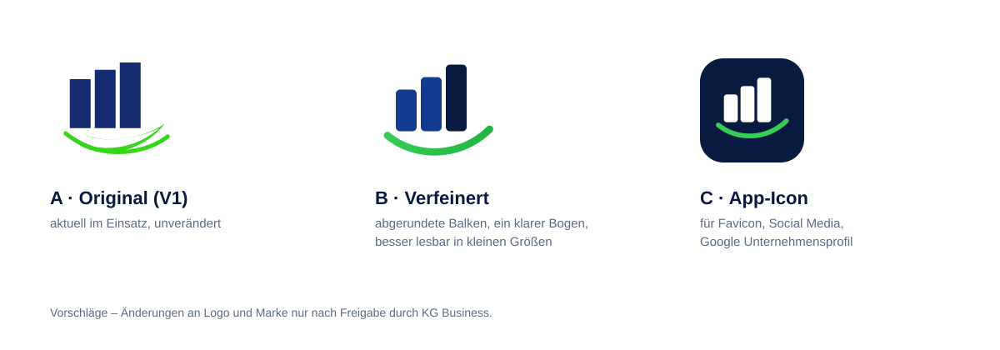

# Logo und Marke

## Aktueller Stand
Die Website verwendet die **Bildmarke aus der V1 unverändert** (drei steigende Balken, grüner Bogen) mit der Wortmarke „KG-BUSINESS“ und dem Claim „Energie. Einfach. Persönlich.“ (`src/components/brand/Logo.tsx`).

Ob dies das offizielle Logo ist, konnte nicht geprüft werden (Live-Website nicht erreichbar). **Bitte das offizielle Logo als SVG bereitstellen**, falls abweichend – der Austausch erfolgt an einer einzigen Stelle.

## Verbesserungsvorschläge (nicht umgesetzt)

- **A – Original:** bleibt, wenn keine Änderung gewünscht ist.
- **B – Verfeinert:** gleiche Bildidee, abgerundete Balken und ein einzelner, sauberer Bogen statt der überlagerten Formen; wirkt in kleinen Größen (Header, Favicon) ruhiger und hochwertiger.
- **C – App-Icon:** quadratische Variante für Favicon, Social-Media-Profile und Google Unternehmensprofil.

## Schreibweise
- Wortmarke/Impressum: **KG-BUSINESS** (wie V1)
- Fließtext: **KG Business**
Bitte festlegen, ob beide Schreibweisen beibehalten werden sollen.

## Farben
| Token | Hex | Verwendung |
|---|---|---|
| navy-900 | `#081A40` | Hintergründe, Überschriften |
| navy-700 | `#123B91` | Corporate Blue, Akzente |
| electric-500 | `#168BFF` | dekorativ, auf dunklem Grund |
| electric-600 | `#0B6FD8` | Links auf Weiß (4,9:1) |
| energy-400 | `#35CD55` | Primär-CTA (Fläche, Navy-Text 8,1:1) |
| energy-700/800 | `#147A2E` / `#0E5C22` | grüner Text auf Hell |
| ink | `#14223D` | Fließtext |
| soft | `#F4F8FD` | helle Abschnitte |
